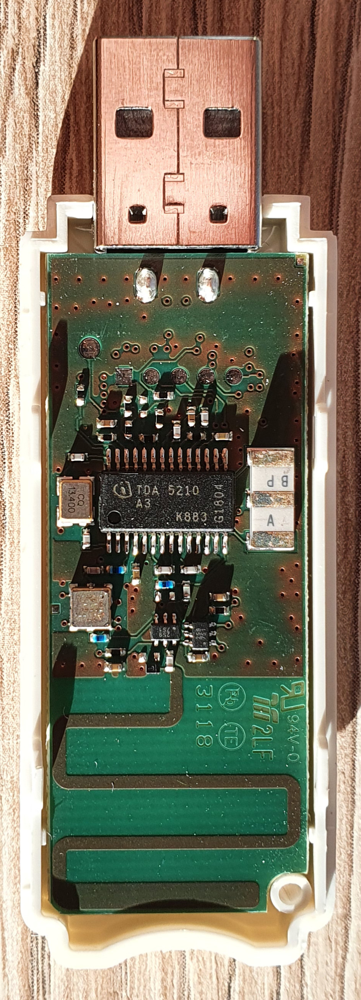

# Becker Centronic for Home Assistant

A modern, UI-first Home Assistant integration for **Becker Centronic** roller
shutters, blinds, awnings and Roto roof windows, controlled through the
**Becker Centronic USB stick**.

Everything is configured from the Home Assistant UI - no YAML, no manual
service calls to pair. A guided wizard walks you through pairing each cover,
and the stick can be plugged into the Home Assistant machine **or into a
remote Raspberry Pi** shared over the network.

## Supported hardware

- Becker Centronic USB stick, order numbers **4035 200 041 0** and
  **4035 000 041 0**
- Becker Centronic roller shutters, blinds and sun protection (CC11/CC31/CC51
  compatible receivers)
- Roto roof windows with Centronic RF remotes

## Features

- **UI setup with guided pairing wizard** - put the cover in pairing mode,
  click, done. Includes retry with alternative pairing sequences for stubborn
  receivers.
- **Local USB or network serial** - use the stick directly or via
  [ser2net on a Raspberry Pi](docs/remote-serial.md) near your covers, with
  automatic reconnection when the link drops.
- **Position tracking** by travel time, with position slider, plus optional
  position source via a value template (e.g. window sensors).
- **Intermediate positions** (ventilation / sun protection) and two tilt
  modes: intermediate positions or blind slat tilt.
- **Remote tracking** - Home Assistant follows commands from your physical
  remotes, keeping positions in sync, firing
  `becker_centronic_remote_packet_received` events and offering device
  triggers for automations.
- **Recovery tools** - a per-cover *Resync* button and `resync`, `unpair`,
  `pair_master` and `clear_position` actions fix "cover stopped responding"
  situations without touching any files.
- **Import from previous setups** - increments from an existing
  `centronic-stick.db` (old becker integration or centronic-stick.py) are
  imported automatically, so already-paired covers keep working.

## Installation

### HACS (recommended)

1. In HACS, open the menu and choose **Custom repositories**.
2. Add `https://github.com/petrleocompel/hass-becker-centronic` with category
   **Integration**.
3. Search for **Becker Centronic**, install it and restart Home Assistant.

### Manual

Copy `custom_components/becker_centronic` into the `custom_components` folder
of your Home Assistant configuration directory and restart Home Assistant.

## Setup

1. Plug in the USB stick - into the Home Assistant machine, or into a remote
   Linux box set up according to the [remote serial manual](docs/remote-serial.md).
   Use a short USB extension cable to keep the stick away from other RF
   sources if reception is poor.
2. Go to **Settings → Devices & services → Add integration** and pick
   **Becker Centronic**.
3. Choose how the stick is connected (local USB port or network host/port).
   If a `centronic-stick.db` from a previous installation is found, you will
   be offered to import it.
4. On the integration page press **Add cover** and follow the
   [pairing wizard](docs/pairing.md).

## Units and channels

The USB stick emulates up to **5 remote units** with **7 channels** each -
35 covers in total. Each cover gets one unit/channel combination; the wizard
suggests the next free one automatically. Channel 15 is a broadcast to all
channels of a unit (used internally).

## Position tracking

There is no feedback channel from Becker covers, so the integration models
the position:

- **Travel time**: measure how many seconds the cover needs to fully open and
  close, enter it in the cover settings, and you get a position slider and
  sensible position state.
- **Value template**: optionally derive the position from other entities,
  e.g. close state from a rain sensor on a roof window.
- **Remote tracking**: add your physical remote's ID to the cover settings
  and Home Assistant updates the position whenever you use the remote. Find
  the ID in the debug log (see [troubleshooting](docs/troubleshooting.md)).

## Automations on remote button presses

Every received remote command fires a
`becker_centronic_remote_packet_received` event with `unit`, `channel` and
`command` data. Covers with configured remote IDs additionally offer device
triggers ("Remote command up received", ...) directly in the automation
editor.

## Documentation

- [Pairing guide](docs/pairing.md)
- [Remote serial setup (Raspberry Pi + ser2net)](docs/remote-serial.md)
- [Troubleshooting](docs/troubleshooting.md)

## Credits

This integration builds on the protocol work of
[ole1986/centronic-stick](https://github.com/ole1986/centronic-stick),
[nicolasberthel/pybecker](https://github.com/nicolasberthel/pybecker) and
[RainerStaude/hass-becker-component-plus-pybecker](https://github.com/RainerStaude/hass-becker-component-plus-pybecker).
Licensed under the [MIT license](LICENSE).
